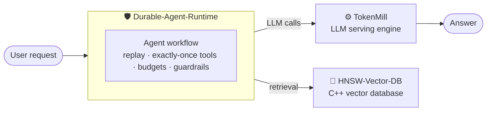

<!-- ============================== HEADER ============================== -->
<p align="center">
  
</p>

<p align="center">
  <a href="https://koduruchandrasekhar.vercel.app">
    
  </a>
</p>

<p align="center">
  <a href="https://koduruchandrasekhar.vercel.app"></a>
  <a href="https://www.linkedin.com/in/koduru-chandrasekhar/"></a>
  <a href="https://leetcode.com/u/Koduru_Chandrasekhar/"></a>
  <a href="mailto:koduruchandrasekhar10@gmail.com"></a>
  <a href="https://koduruchandrasekhar.vercel.app/assets/Koduru_Chandrasekhar_Resume.pdf"></a>
</p>

<p align="center">
  
  
  
</p>

<h3 align="center"><i>"If it's written in your destiny, write it yourself."</i></h3>

---

## 🧠 `whoami`

```python
class KoduruChandrasekhar:
    role      = "AI Engineer & Systems Builder"
    education = "B.Tech CSE @ JNTUH UCESTH (2024 - 2028)"
    cgpa      = 9.48
    leetcode  = "440+ problems solved"
    builds    = ["LLM serving engines", "vector databases", "AI agent runtimes",
                 "computer vision systems", "RAG", "quantum ML", "GPU compute"]
    principle = "Tested. Explainable. Shipped."
    motto     = "If it's written in your destiny, write it yourself."

    def how_i_work(self):
        return {
            "tests":       "real test suites and CI, not demos that only work once",
            "explanations": "SHAP, cited answers, honest baselines, statistical tests",
            "guardrails":  "RBAC, PII redaction, prompt-injection defenses",
        }
```

I work on applied AI (computer vision, RAG, ML) and on the systems underneath it: serving, storage, scheduling and GPU compute.

---

## 🏗️ AI Infrastructure

Three projects on the systems side of AI. Each one is built from scratch and benchmarked against an established library.



<table>
<tr>
<td width="33%" valign="top">

### ⚙️ [TokenMill](https://github.com/KoduruChandrasekhar/TokenMill)
LLM serving engine

- Own PyTorch forward pass + KV cache
- Continuous batching
- Paged KV cache with block allocation and preemption
- Scheduler, OpenAI-compatible API, SSE streaming
- Benchmarks against naive serving, static batching and vLLM

<!-- Add measured result, e.g. "Nx throughput over static batching on a T4" -->

`PyTorch` `FastAPI` `Triton`

</td>
<td width="33%" valign="top">

### 🧭 [HNSW-Vector-DB](https://github.com/KoduruChandrasekhar/HNSW-Vector-DB)
Vector database in C++20

- HNSW index and product quantization
- AVX2 / NEON SIMD kernels
- Write-ahead log, segments, crash recovery
- Filtered search with a query planner
- Benchmarks against hnswlib and FAISS

<!-- Add measured result, e.g. "recall@10 0.95 at N QPS on SIFT1M" -->

`C++20` `SIMD` `CMake`

</td>
<td width="33%" valign="top">

### 🛡️ [Durable-Agent-Runtime](https://github.com/KoduruChandrasekhar/Durable-Agent-Runtime)
Execution runtime for AI agents

- Recovery by replaying an event log
- Idempotent tool calls and compensations
- Leases with fencing tokens
- Model gateway with budgets and caching
- Policy checks and human approvals
- Chaos tests

<!-- Add measured result, e.g. "1,000 runs, random worker kills: 0 lost, 0 duplicate refunds" -->

`Go` `Python` `PostgreSQL` `gRPC`

</td>
</tr>
</table>

---

## 🚀 Applied AI Projects

<table>
<tr>
<td width="50%" valign="top">

### 🚦 [TraceNet](https://github.com/KoduruChandrasekhar/TraceNet) · [Live demo](https://tracenet-ten.vercel.app/)
**City-wide multi-camera vehicle tracking**

- ANPR pipeline: YOLO11, ByteTrack, PP-OCRv5
- Combines plate text, OSNet re-ID and road-network travel time into one vehicle ID across cameras
- Flags possible cloned plates from impossible travel times
- Trajectories, origin-destination matrices, congestion analytics on a GIS dashboard
- Event-driven backend: RabbitMQ, Redis, PostGIS, WebSockets, JWT, RBAC, hash-chained audit log

`YOLO11` `OSNet` `FastAPI` `PostGIS` `React` `Docker`

</td>
<td width="50%" valign="top">

### 💳 CredX
**AI-powered credit decisioning engine**

- Automates 70% of financial data ingestion
- Cut Credit Appraisal Memo generation time by 85%
- Parses unstructured financial PDFs into scoring signals
- Graph cycle detection to flag circular trading
- SHAP explanations on credit decisions

`Python` `NLP` `Graph Algorithms` `SHAP`

</td>
</tr>
<tr>
<td width="50%" valign="top">

### ⚛️ QuantaDx
**Hybrid quantum-classical ML for early disease detection**

- Quantum-kernel SVM on PCA-compressed features (ZZ feature map)
- Nested-CV bandwidth tuning raised accuracy from 81.5% to 94.0% (5-fold CV, 569 patients)
- Fused quantum + RBF kernels, sensitivity-first threshold
- McNemar tests against classical baselines; SHAP in a web app

`Qiskit` `Scikit-learn` `SHAP` `React`

</td>
<td width="50%" valign="top">

### 💹 Financial RAG
**Cited question answering over SEC filings**

- Answers cite their source passages
- PDF parsing, chunking, embeddings, vector search
- 118-test suite

`Python` `LLMs` `RAG` `Vector Search`

</td>
</tr>
</table>

<details>
<summary><b>📦 More things I've built</b></summary>
<br/>

| Project | What it does | Stack |
| --- | --- | --- |
| ⚡ **HC4J** | Heterogeneous GPU compute framework with no CUDA lock-in: WebGPU + WGSL shaders, Java FFM for zero-overhead interop, Rust data pipelines | Java, FFM API, Rust, WebGPU |
| 🩺 **MediSense AI** | Helps doctors read medical reports faster | Python, ML |
| 👁️ **SightPulse** | Modular computer-vision platform: real-time inference turned into containerized microservices | OpenCV, YOLO, DeepFace, MediaPipe, Docker |
| 🏙️ **UrbanIQ** | Urban intelligence project | Python |

</details>

---

## 🔬 Research

**Robustness of Skin Lesion Segmentation to Dermoscopic Artifacts** *(ongoing)*

- Question: do a segmentation model's attention and uncertainty signal failure before its accuracy drops?
- UNet++ and Attention U-Net on a ResNet-34 encoder, 3 seeds: 0.90 mean Dice on 518 held-out ISIC 2018 images
- Seeded synthetic artifacts (hair, ink marker, dermoscope frame) at 5 severity levels
- Measures Dice drop, LayerCAM attention and Monte Carlo Dropout uncertainty

`PyTorch` `UNet++` `Attention U-Net` `LayerCAM`

---

## 💼 Experience & Leadership

| Role | Where | When |
| --- | --- | --- |
| **Technical Coordinator** | E-Cell (Entrepreneurship Cell), JNTU Hyderabad | 2026 – Present |
| **AI/ML Intern** | IICT | Jun – Jul 2026 |

At E-Cell I'm building the official JNTUH E-Cell website, with event pages, registration, an admin dashboard and a live Instagram feed.

---

## 🏆 Achievements & Certifications

- 🥇 **Winning team, TCS Tech Day Hackathon**, held at JNTU Hyderabad (2026)
- 🧩 **440+** DSA problems solved on [LeetCode](https://leetcode.com/u/Koduru_Chandrasekhar/)
- 🎓 **CGPA 9.48 / 10**, B.Tech CSE, JNTUH UCESTH
- 📜 Machine Learning Specialization, Stanford Online (Andrew Ng)
- 📜 Oracle Cloud Infrastructure AI Foundations Associate

---

## 🛠️ Tech Arsenal

<p align="center">
  <br/>
  <br/>
  
</p>

| Area | Stack |
| --- | --- |
| **AI Infrastructure** | LLM serving, continuous batching, KV-cache management, vector search (HNSW, PQ), agent runtimes |
| **AI / ML** | PyTorch, TensorFlow, Scikit-learn, XGBoost, LightGBM, SHAP, Qiskit |
| **Computer Vision** | YOLO11, ByteTrack, OSNet re-ID, PaddleOCR, UNet++, OpenCV |
| **LLMs** | RAG, agents, embeddings, guardrails, evals |
| **Backend** | FastAPI, Django, Node.js, gRPC, WebSockets, RabbitMQ, Redis |
| **Data** | PostgreSQL, PostGIS, MySQL, MongoDB |
| **Systems** | C++20, SIMD, concurrency, storage engines, crash recovery, GPU compute (WebGPU) |
| **DevOps** | Docker, Kubernetes, GitHub Actions, GCP, AWS |

---

## 📊 Stats

<p align="center">
  
  
</p>

<p align="center">
  
</p>

<p align="center">
  <a href="https://leetcode.com/u/Koduru_Chandrasekhar/">
    
  </a>
</p>

<p align="center">
  
</p>

---

## 🔭 Right Now

- 🔨 Finishing and benchmarking the AI infrastructure projects
- 🔬 Writing up the skin lesion segmentation study
- 🌍 Contributing to open-source AI infrastructure
- 💼 Looking for SWE and AI/ML internships: [email me](mailto:koduruchandrasekhar10@gmail.com)

---

<p align="center">
  <picture>
    <source media="(prefers-color-scheme: dark)" srcset="https://raw.githubusercontent.com/KoduruChandrasekhar/KoduruChandrasekhar/output/github-contribution-grid-snake-dark.svg" />
    <source media="(prefers-color-scheme: light)" srcset="https://raw.githubusercontent.com/KoduruChandrasekhar/KoduruChandrasekhar/output/github-contribution-grid-snake.svg" />
    
  </picture>
</p>

<h3 align="center"><i>Giving up is not in the blood.</i></h3>

<p align="center">
  
</p>
